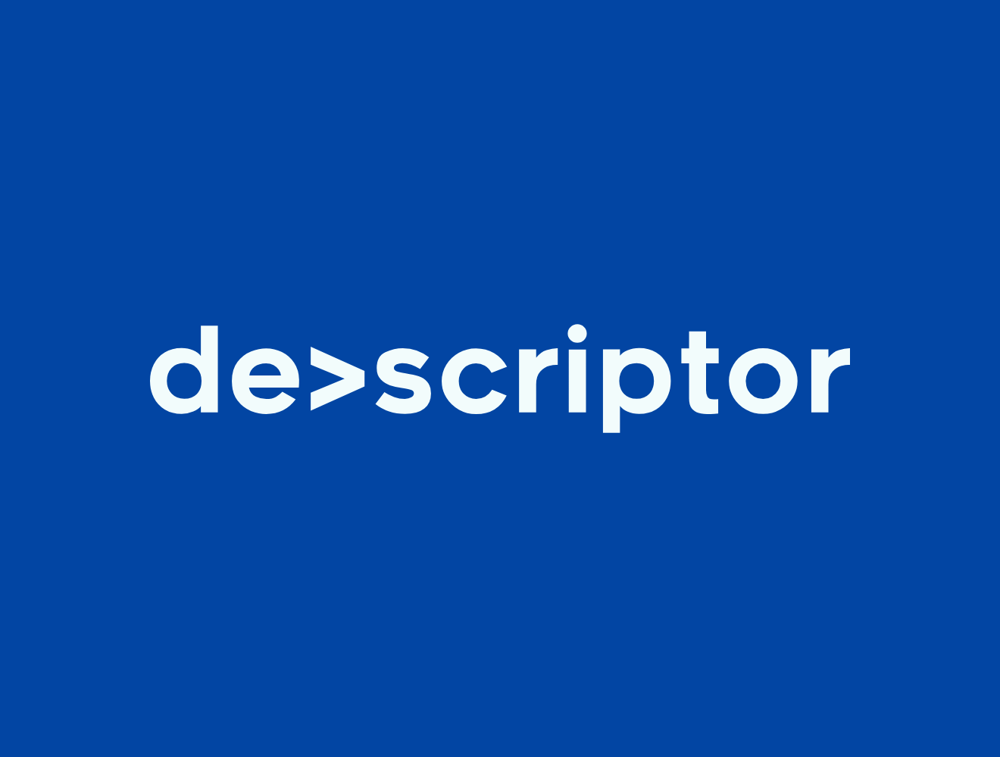

# Devscriptor

<p align="center">
  
</p>

A local code-intelligence engine for developers and AI coding agents. Devscriptor
parses a codebase with tree-sitter into a SQLite knowledge graph of entities and
relationships, searches it by name, keyword and meaning with a local embedding
model, navigates it through language servers, and serves all of it to agents as
one MCP server — without sending your code anywhere.

- **26 languages and frameworks** parsed with tree-sitter: Python, Rust,
  TypeScript/TSX, JavaScript, Go, Java, C, C++, C#, Ruby, PHP, Swift, Kotlin,
  Scala, Dart, Bash, SQL, Solidity, F#, GraphQL, HTML, Objective-C, CUDA, VB.NET,
  Svelte and Vue, plus Markdown documentation, a section at a time.
- **A knowledge graph** of functions, classes, types, modules and more, with calls,
  type uses, inheritance, implementations, members and imports resolved across
  files, kept current by incremental scans and a real-time watcher.
- **Hybrid search**: FTS5 keyword search right after a scan, fused with semantic
  search over `jinaai/jina-embeddings-v2-base-code` vectors computed on your
  machine.
- **Language-server navigation**: definitions, references, hovers, call and type
  hierarchies, diagnostics and renames from 21 language servers, detected on your
  system or installed on request.
- **An MCP server of 75 tools** for AI agents, shared by every client of a
  workspace, with answers that re-check the files they name.
- **A Context Graph**: long-term notes — decisions, standards, failures — linked to
  the code they are about.
- **Local and private**: no API keys, no telemetry; the network is used only to
  download the embedding model once and the language servers you ask for.
- **One self-contained binary** for Linux, macOS and Windows.

## Install

Pre-built archives for Linux (x86_64, aarch64), macOS (Apple Silicon, Intel) and
Windows (x86_64) are published with each [GitHub release](https://github.com/vladimirpesic/devscriptor/releases/latest), each
holding the one `devscriptor` executable; see [Installation](docs/installation.md).

Or build from source with Rust 1.95 or newer and a C compiler:

```bash
git clone https://github.com/vladimirpesic/devscriptor.git && cd devscriptor
cargo build --release -p devscriptor-cli       # target/release/devscriptor
```

## Quick start

```bash
devscriptor scan ./my-project          # parse and index: keyword search is ready
devscriptor search "parse_config"      # entities whose name contains the query
devscriptor embed                      # compute the vectors for semantic search
devscriptor find-similar "retry with exponential backoff"
devscriptor lsp setup ./my-project     # install the language servers it needs
```

Give an AI agent the MCP server by configuring its client to start
`devscriptor mcp`:

```json
{
  "mcpServers": {
    "devscriptor": { "command": "devscriptor", "args": ["mcp"] }
  }
}
```

`devscriptor doctor` checks the setup: the model cache, the project
configuration, the database, disk space and memory.

## Documentation

| Guide | What it covers |
| --- | --- |
| [Installation](docs/installation.md) | Installing, first steps, language servers, updating, uninstalling, troubleshooting |
| [CLI](docs/cli.md) | Every `devscriptor` command and its options |
| [Configuration](docs/configuration.md) | The project's `devscriptor.yaml` and the environment variables |
| [MCP server](docs/mcp.md) | Running the server, the shared process per workspace, and the 75 tools |
| [Language servers](docs/lsp.md) | Detection, installation, lifecycle and configuration of the 21 language servers |
| [Language server prerequisites](docs/lsp-servers.md) | What each language server needs to run |
| [Context Graph](docs/context-graph.md) | Long-term notes for agents: tools, CLI, search, pruning |
| [Watcher](docs/watcher.md) | How the index follows file changes |
| [Architecture](docs/architecture.md) | The crates, the pipeline, the relationship graph, search, the database and the server processes |
| [Performance](docs/performance.md) | Memory and throughput: two-phase indexing, the embedding tuner, the database layer |
| [Design decisions](docs/decisions.md) | The choices that shape Devscriptor, and why |
| [Privacy](docs/privacy.md) | What uses the network, and where data is stored |
| [Security](docs/security.md) | Verification, file access, the server endpoint, `unsafe` code |
| [Building](docs/building.md) | Building from source, tests, release builds, the language server and model mirrors |
| [VS Code extension](vscode-extension/README.md) | Devscriptor in Visual Studio Code |

## Project structure

```text
crates/
├── core/    # devscriptor-core: parsing, the database, the pipeline, search, embeddings, analysis
├── lsp/     # devscriptor-lsp: language server detection, installation and the LSP bridge
├── mcp/     # devscriptor-mcp: the MCP server, its tools and the shared per-workspace server
└── cli/     # devscriptor-cli: the `devscriptor` binary
scripts/            # language server and embedding model mirror scripts, per platform
vscode-extension/   # the VS Code extension
```

## Development

```bash
cargo fmt --all --check
cargo clippy --workspace --all-targets -- -D warnings
cargo test --workspace
```

See [Building](docs/building.md) for the slow and ignored test suites and the
extension's tests.

## License

Devscriptor is licensed under the [Apache License, Version 2.0](LICENSE).
